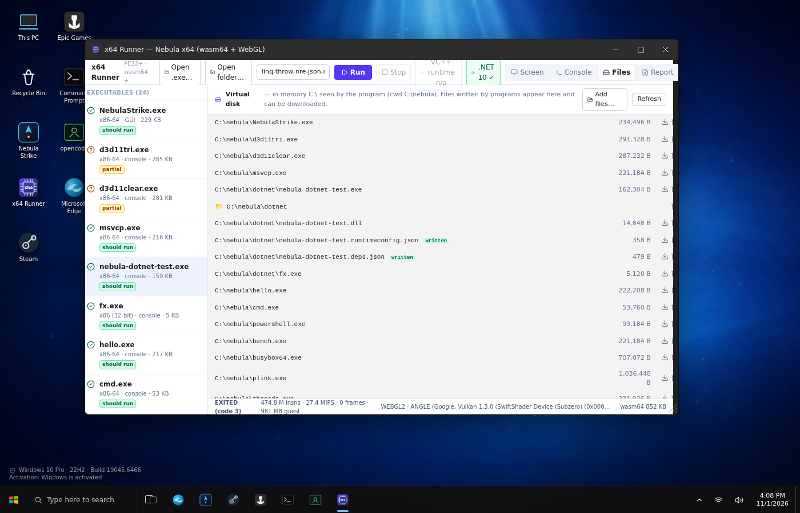

# nebula_gaming — Nebula OS + **Nebula x64**: real Windows x86‑64 executables in the browser (wasm64 + WebGL)

`nebula_gaming` = the Nebula OS web desktop **plus an x86‑64 user‑mode emulator with a Win32 personality**,
written in C, compiled with `zig cc -target wasm64-freestanding` (true 64‑bit WebAssembly, memory64) and
presented through WebGL.  It runs unmodified PE32+ `.exe` files inside the **x64 Runner** app — in the
browser, in the PWA and in the Android APK (any Chromium ≥ 133 / WebView ≥ 133).




## What the emulator is (and is not)

| layer | implemented | notes |
|---|---|---|
| CPU | x86‑64 integer ISA, SSE/SSE2 (+ the SSE4.1/AVX‑free subset compilers emit at `-O2`, SSE3 `movddup`/`movs[lh]dup`), **x87 FPU subset** (load/store/arith/compare/transcendentals, 53‑bit precision) | interpreter with a decode cache + fast paths for the hot opcodes (v1.15): ~40 MIPS in Chromium (wasm64), ~60–65 MIPS native C |
| Loader | PE32+ exe **and the program's own DLLs** (relocations, imports by name/ordinal, exports + forwarders, `DllMain`, static TLS per image and per thread, TLS callbacks, data imports such as `_environ`/`_iob`), `LoadLibrary`/`GetProcAddress`/`GetModuleHandle` on real modules, command line, environment, TEB/PEB | 32‑bit PE and .NET are rejected with an honest verdict; system DLLs are always the emulator's shims |
| KERNEL32 | heap, virtual memory, **threads + synchronisation** (`CreateThread`, critical sections, SRW locks, condition variables, events, mutexes, semaphores, `WaitFor{Single,Multiple}Objects(Ex)`, `WaitOnAddress`, `InitOnce`, `QueueUserAPC`, thread TLS/static TLS, winpthreads), TLS/FLS, time/QPC, console I/O **+ stdin**, **in‑memory file system** (`CreateFile/ReadFile/WriteFile/SetFilePointer/FindFirstFile/GetFileAttributes/Create‑Delete‑Move/Current directory/file mappings`), dynamic environment block, **processes** (`CreateProcessA/W`, `WaitForSingleObject/WaitForMultipleObjects`, `GetExitCodeProcess`, `TerminateProcess`, `OpenProcess`, Toolhelp snapshot, `ReadProcessMemory`, psapi names), **anonymous pipes** (`CreatePipe`, `PeekNamedPipe`, handle inheritance via `SECURITY_ATTRIBUTES`/`SetHandleInformation`/`STARTF_USESTDHANDLES`), locale stubs | up to 32 processes and their threads share one cooperative scheduler inside the wasm module; the disk lives in RAM — mount a folder, download what the program wrote |
| UCRT / msvcrt | printf family (ANSI + wide), string/memory/ctype, math (via host), malloc, qsort/bsearch, time/strftime, getenv/putenv, atexit, setjmp, **stdio on real files** (`fopen/fread/fgets/getc(_filbuf)/fseek/ftell/_open/_read/_write/_lseek/_stat/_access/_unlink/rename/_mkdir/_getcwd/dup/dup2`) | redirections `>`/`<` work in busybox `sh`; pipes/`$(…)` need child processes |
| **SEH / C++ exceptions** | x64 table‑based unwinding (`.pdata`/`UNWIND_INFO`, chained info, epilogue detection): `RaiseException`, two‑phase dispatch, `RtlUnwindEx`/`RtlRestoreContext` incl. `STATUS_UNWIND_CONSOLIDATE` and collided unwinds, `RtlVirtualUnwind`/`RtlLookupFunctionEntry`/`RtlCaptureContext`, `__C_specific_handler` (`__try/__except/__finally`), **MSVC `__CxxFrameHandler`/`__CxxFrameHandler3`** (FuncInfo tables, cleanup funclets, catch by value/reference/`...`, nested catches, rethrow) and the gcc/libunwind path (`_CxxThrowException`, `STATUS_GCC_THROW`) **Hardware faults of the interpreter (access violation, divide by zero, `ud2`) are dispatched as SEH exceptions** at the faulting instruction (`EXCEPTION_RECORD` with address/rw, continuable), vectored exception handlers (`AddVectoredExceptionHandler`, `EXCEPTION_CONTINUE_EXECUTION` with a patched `CONTEXT`), `SetUnhandledExceptionFilter` callback | `__CxxFrameHandler4` (VS2019 compressed tables) not yet; `_set_se_translator`/`exception_ptr` stubs |
| USER32 / GDI32 | windows, message loop, timers, keyboard/mouse, DCs, DIBs, BitBlt/StretchBlt, pens/brushes, text (bitmap font) | **no OpenGL/Vulkan, no audio, no dialog resources** |
| **D3D11 / DXGI → WebGL2** | the DXVK‑style translation layer: real COM vtables generated from `d3d11.h`/`dxgi.h`, `D3D11CreateDevice(AndSwapChain)`, device/context/swap chain objects, textures, render‑target/depth/shader‑resource views, buffers, shaders, states, `Map/Unmap/UpdateSubresource`, `ClearRenderTargetView` + `Present` into the window (WebGL2 canvas / PPM frames), **DXBC (SM4/5) → GLSL ES 3.00 translator** (`emu/x64/dxbc.c`, ~90 opcodes) and a WebGL2 back end (`src/lib/x64/gfx.ts`) executing `Draw`/`DrawIndexed` with input layouts, constant buffers, textures/samplers, blend/depth/raster state — `d3d11tri.exe` renders a shaded triangle + indexed quad in the browser (`docs/D3D11-X64.md`) | instancing, compute/geometry/tessellation, MSAA, resource copies, DXGI adapter enumeration, D3D9 — unimplemented methods stop with their name; the CPU interpreter (~40 MIPS in the browser) caps this at demos and small tools, not games  |
| **WS2_32** | Winsock 2 over the host TCP stack (native runner): `socket/connect/bind/listen/accept`, `send/recv`, `WSASend/WSARecv` + IOCP, `ConnectEx/AcceptEx`, `select`/`WSAPoll`, `getaddrinfo`; this is what libuv (node.exe) and uSockets (Bun) use — HTTPS works end‑to‑end (OpenSSL in node, BoringSSL in Bun); **blocking sockets** park the thread like on Windows (`connect/accept/recv` on sockets without `FIONBIO`), `send`/`WSASend` never return short counts (per‑socket send queue flushed by the scheduler), incoming data is read ahead into a host buffer so a slow guest never closes the TCP window, `GetOverlappedResult`/`WSAGetOverlappedResult(bWait)` really wait (v1.15.1, `tests/netloop.exe`) | the browser has no raw TCP: in wasm64 every socket call fails with `WSAENETDOWN` instead of hanging |
| **NTDLL** | the `Nt*/Rtl*` subset that Zig std, libuv and Bun call directly (`NtCreateFile/NtReadFile/NtWriteFile/NtQueryInformationFile/NtSetInformationFile/NtQueryDirectoryFile/Nt*VirtualMemory/NtQuerySystemInformation`, `RtlNtStatusToDosError`, …), PEB `ProcessParameters` with real std handles/command line/environment | — |
| **Node‑API / Bun add‑ons** | `.node` add‑ons delay‑load `napi_*` from `node.exe`; `GetProcAddress` resolves them from the host exe's own export table (Bun exports 512 symbols) | — |
| ADVAPI32 / COMCTL32 | stubs that fail cleanly | — |
| **kernel32 thread pool (v1.16.1)** | `CreateThreadpoolWork/SubmitThreadpoolWork/WaitForThreadpoolWorkCallbacks/CloseThreadpoolWork`, `*Timer` (one-shot + periodic, `IsThreadpoolTimerSet`), `*Wait` (handle + timeout → `TP_WAIT_RESULT`), `TrySubmitThreadpoolCallback`, `SetEvent/ReleaseSemaphore/ReleaseMutex/LeaveCriticalSection/FreeLibraryWhenCallbackReturns`, `CallbackMayRunLong`, pools, stack information, cleanup groups — every callback runs on its own helper thread with a per-invocation `PTP_CALLBACK_INSTANCE` (`emu/tests/tpool.c`: 14/14) | thread-pool I/O (`CreateThreadpoolIo`) not implemented; cleanup groups do not track members |
| **Windows runtime components (v1.16)** | **the real Microsoft Visual C++ 2015–2022 Redistributable DLLs run inside the emulator**: `msvcp140*.dll`, `vcruntime140_1.dll`, `concrt140`, `vcomp140`, `vcamp140`, `vccorlib140`, `mfc140*` are downloaded from Microsoft at build time (`emu/tools/runtime-pack.sh`, CI job *runtime pack*) into `/x64/sys32/` and installed on demand into `C:\Windows\System32` (the **VC++ runtime** button in x64 Runner, or automatically when a program imports one of them). DLL search order is Windows': exe directory → `AddDllDirectory`/`SetDllDirectory` → `System32` → cwd → `PATH`; for vendor-runtime names (`msvcp*`, `msvcr*`, `concrt`, `vcomp`, `vcamp`, `vccorlib`, `mfc*`, `vcruntime140_1/_threads`, `libstdc++`/`libgcc`/`libwinpthread`, `gdiplus`, `d3dcompiler_*`, `d3dx*`, `xinput1_3`, `x3daudio`) a real file wins over the built-in shim; core OS DLLs (kernel32, ntdll, ucrtbase, user32, …) are always built-in. The UCRT internals the real `msvcp140` imports are implemented (`_lock_locales`, `_Getdays/_Gettnames/_Strftime`, `_get_stream_buffer_pointers`, `__processing_throw`, `<fenv.h>`, ~150 float/long-double/**C99 complex** math functions with the MSVC x64 struct ABI, `__stdio_common_vsscanf/vfscanf`) | thread-pool **I/O** callbacks (`CreateThreadpoolIo`) are not implemented (stop with the API name); FP-exception flags (`fetestexcept`) reflect only what the interpreter raises; MFC GUI apps still need dialog resources / common controls |
| **.NET (v1.17)** | **the official Microsoft .NET Runtime 10 (win-x64) runs inside the emulator** — CoreCLR, RyuJIT, the GC and the framework assemblies, unmodified, downloaded from builds.dotnet.microsoft.com at build time (`emu/tools/dotnet-pack.sh`, CI job *.NET pack*, 191 files / 34 MB gz) into `/x64/dotnet/` and installed on demand into `C:\Program Files\dotnet` (the **.NET 10** button, or automatically when a .NET program is started). Apphost exes run as the launchers they are (`DOTNET_ROOT`); managed `.dll`s and **classic .NET Framework IL-only exes** are redirected to `dotnet.exe exec` (a `runtimeconfig.json` is generated for Framework apps: net10.0 compatibility mode). CoreCLR needed real `Get/SetThreadContext` + GC thread redirection, `RtlVirtualUnwind` with `KNONVOLATILE_CONTEXT_POINTERS`, a stack-aware `VirtualQuery` (guard pages), W^X off, overlapped Winsock with captured `WSABUF`s. Measured: LINQ/exceptions/hardware NRE/JSON/reflection+dynamic/Regex/GC in 6.4 s, GC while a thread spins, `Process.Start`, `HttpClient` over HTTP, a net48 exe in 2.2 s — see [docs/DOTNET-X64.md](docs/DOTNET-X64.md) | **HTTPS/TLS not implemented** (no SChannel); invariant globalization (no ICU — cultures accepted, formatting invariant, `TimeZoneInfo.Local` = UTC); **no WinForms/WPF** (Windows Desktop runtime + user32/DirectX beyond the subset); self-contained single-file bundles untested; everything is interpreted (JIT included), so start-up is ~2 s native / 5–8 s in the browser; ~1 GB guest address space reserved by the runtime (committed lazily) |

The **PE compatibility scanner** (`x64_inspect`) reads any `.exe` and reports architecture, subsystem, every
import and whether it is implemented, then gives a verdict: *should run* / *partial* / *unlikely* / *unsupported*.
At runtime the first unimplemented call stops the program with the API name, RIP and opcode bytes — never a silent hang.

### Measured (CI + this repo's test suite)

| executable | origin | result |
|---|---|---|
| `hello.exe` (UCRT console) | this repo | all output correct, exit code 7, 4.4 M instr |
| `bench.exe` (sieve/mandelbrot/memcpy) | this repo | correct; 60–65 MIPS native, 41 MIPS wasm64 (Chromium) — was 40 / 23 before v1.15 |
| `NebulaStrike.exe` (Win32 GDI game, PE32+) | this repo | plays at 60 fps in the browser, ~245 fps headless |
| `busybox64.exe` (busybox‑w32, mingw64‑gcc 16) | frippery.org | file applets work on the virtual disk: `ls -l cat wc sort head tail grep sed awk cut find diff cmp cp tee xxd base64 md5sum sha256sum stat du mkdir gzip` + stdin; **`sh` is a real shell now**: pipelines (`seq 1 5 \| sort -rn \| head -2`), `$(…)`, background jobs `&`/`wait`/`kill`, `ps` (reads sibling processes' command lines through `ReadProcessMemory`), `xargs -I{} sh -c`, `yes \| head` (EPIPE), 1 MB through a pipe, `time` — each stage is a separate emulated process (busybox‑w32 `--forkshell` via `_spawnve` + inherited file mapping); sockets still stop at Winsock |
| `threads.exe` / `pthreads.exe` (Win32 threads + sync / mingw winpthreads) | this repo | 39/39 and 9/9 checks native and in Chromium (wasm64); 4 CPU‑bound threads 43 MIPS aggregate |
| **`sqlite3.exe` (SQLite 3.50.4, official MSVC build)** | sqlite.org | `:memory:` and **file databases** (LockFileEx, OVERLAPPED offsets): 2000‑row table + index + `pragma integrity_check` → ok, in the browser 17 MIPS |
| **`jq.exe` (jq 1.8.1)** | github.com/jqlang | filters, `-s`, math, `--version` — correct output |
| **`lua54.exe` + `lua54.dll` (Lua 5.4.2)** | luabinaries | the exe imports the interpreter DLL → loaded from the virtual disk at its preferred base; scripts, `io.open`, `os.date` work (31 M instr / 2 s wasm64) |
| **`7z.exe` + `7z.dll` (7‑Zip 25.01)** and `7za.exe` | 7‑zip.org | `7z.dll` loaded via `LoadLibrary` + `GetProcAddress("CreateObject")`; `a`/`x`/`l`/`i`/`b` work, 7z/zip round trips bit‑exact; `b -mmt1` ≈ 34 MIPS |
| **`zstd.exe` (Zstandard 1.5.7, MSVC)** | github.com/facebook/zstd | compress/decompress round trips, built‑in benchmark (`-b1 -e3`) runs |
| **`rg.exe` (ripgrep 14.1.1, Rust, x86_64-pc-windows-msvc)** | github.com/BurntSushi/ripgrep | single files and directory trees, regex, `-c`/`-n`/`--stats`, `-j4` worker threads — identical counts to GNU grep; Rust std's Win32 layer (`NtReadFile`, SRW locks, `WaitOnAddress`, waitable timers, `GetFinalPathNameByHandleW`, `ProcessPrng`) |
| **`fd.exe` (fd 10.2.0, Rust)** | github.com/sharkdp/fd | file finder: `-e`, `-t f`, `-S`, coloured output; `-x cmd /c echo found {}` and `-X jq.exe` spawn children through the built‑in `cmd.exe` |
| **`cmd.exe` (the emulator's own Command Prompt, 53 KB, kernel32 only)** | this repo (`emu/cmd/cmd.c`) | embedded at `C:\Windows\System32\cmd.exe`, so `system()`, `_popen`, `os.system`, `os.popen`, `subprocess(shell=True)` and `rg --pre` work; batch files (`demo.bat`), `/c` `/k` and the interactive prompt; builtins `echo set set /a if for (/l /f) call goto exit /b dir type copy del ren md rd cd pushd popd find findstr sort more ver date time pause rem`, `& && \|\| \|`, `> >> < 2>&1`, `(…)` groups, `%VAR%` `%~n1` `%ERRORLEVEL%` `%RANDOM%`; **not** implemented: delayed expansion `!V!`, `usebackq`, `attrib`, `mklink`, `choice`, `%%` stays literal in `/c` mode |
| **`powershell.exe` (the emulator's own PowerShell subset, 91 KB, kernel32 only)** | this repo (`emu/pwsh/pwsh.c`) | embedded at `C:\Windows\System32\WindowsPowerShell\v1.0\powershell.exe` (on `PATH`), so tools that shell out to PowerShell work — opencode unpacks its ripgrep download with the exact `cmd.exe /d /s /c "powershell.exe ^"-NoProfile^" … Expand-Archive …"` spawn; `-Command` / `-File` / `-NoProfile -NonInteractive -ExecutionPolicy`; cmdlets `Expand-Archive`, `[System.IO.Compression.ZipFile]::ExtractToDirectory` (own inflate, verified byte-exact against the host), `Get-FileHash` (own SHA-256), `Get-ChildItem -Recurse -File -Name`, `Get/Set/Add-Content`, `Select-String`, `Where-Object { $_ -like … }`, `Select-Object -First/-Last`, `Measure-Object`, `Test-Path`, `Join-Path`, `New-Item`, `Copy/Move/Remove-Item`, `Write-Output/Host`, `$env:`, `-f`, `-join`, `-eq -like -match -and -or`, string methods, `try/catch`, `if/foreach/while`, `&` external programs, `cmd /c`, `exit N`; **not** implemented: real .NET objects (everything is strings/numbers/line lists), modules, classes, remoting, `Invoke-WebRequest` |
| **`python.exe` (CPython 3.12.10, official python.org embeddable build, MSVC v.1943)** | python.org | the whole interpreter: `python312.dll` (4.3 MB), stdlib from `python312.zip` (zipimport), C extensions `_sqlite3`/`_decimal`/`_ctypes`/`_bz2`/`_lzma`/`pyexpat`/`unicodedata`/`_asyncio`/… as `.pyd`; `-c`, scripts, the **interactive REPL over console stdin** (`ReadConsoleW`), `threading`, `subprocess` with pipes (`python.exe` spawning `python.exe`), `ctypes.windll.kernel32`, file I/O, tracebacks, exit codes; `math` within 1 ulp of the host. Not available: `_ssl`/sockets (no network), `tkinter`, `_wmi`. Start‑up ≈ 60 M instr (2 s native, ~4 s wasm64); the bundle (15 MB) is downloaded lazily on first run |
| **`node.exe` (Node.js 24.11.0, official win‑x64 build, 90 MB)** | nodejs.org | V8 + libuv: `-e` scripts in ~3 s, `npm --version`, `child_process.spawnSync/exec` (libuv named pipes + IOCP zero‑reads → real child stdout), `require('https').get()` → real TLS to the Internet (3.6 s for 70 KB); `fetch()` fails only because undici's wasm llhttp needs a 10 GB reservation |
| **`bun.exe` (Bun 1.4.4, win‑x64‑baseline, 115 MB)** | github.com/oven-sh/bun | JavaScriptCore without JIT: `bun -e` in 3 M instructions (0.08 s), `fetch("https://…")` → status 200 in 0.55 s (uSockets over libuv `select` slow‑poll + BoringSSL), `Bun.spawn`, SQLite, workers |
| **`opencode.exe` (opencode 1.19.5, Bun standalone, 211 MB)** | npm `opencode-windows-x64-baseline` | **the real OpenTUI terminal UI renders and is interactive**: `--version` in 77 s; the TUI (main thread + 12 worker threads, SQLite, 2 Bun DLLs incl. a Node‑API add‑on, the in‑process HTTP server) draws its first frame after ≈ 9 min / 42 G instructions at 65 MIPS, keyboard input reaches the prompt, Enter creates a session and the LLM request goes out over HTTPS — see `docs/screenshots/` |
| **`node.exe` v24.11.0 + `npm install opencode-ai` + `npx opencode`** (official Node.js win-x64 zip, unmodified) | nodejs.org / registry.npmjs.org | the whole npm route runs on the emulated Windows: `npm view opencode-ai version` → `1.19.5` over TLS (2 m 40 s), `npm install` downloads the 80 MB platform tarball, stores it in `npm-cache/_cacache`, extracts the 211 MB `opencode.exe` into `node_modules` (on a `--mount-rw` folder, so it lands on the host disk instead of RAM), runs the `postinstall` script (`cmd.exe /d /s /c node ./postinstall.mjs` → CPU probe through the emulator's `powershell.exe` → `opencode.exe --version` as a child process), and `npx opencode --version` → `node.exe → npx → cmd.exe → node_modules\.bin\opencode.cmd → opencode.exe` prints `1.19.5` in 1 m 40 s; `.github/workflows/npm-opencode-x64.yml` replays it on a runner and then drives the npm-installed TUI. Needed: write-back mounts, `CreateProcess` `lpEnvironment`, real `process.execPath`, `FileDispositionInfo(Ex)` delete semantics (`fs.rmSync` is `std::filesystem::remove_all`) |
| **all 26 DLLs of the VC++ 2015–2022 Redistributable x64** (`msvcp140*`, `vcruntime140*`, `concrt140`, `vcomp140`, `vcamp140`, `vccorlib140`, `mfc140`/`mfc140u`/`mfcm140*` + 10 MFC language DLLs) | microsoft.com | each one `LoadLibrary`s from `C:\Windows\System32` and runs its `DllMain`/static initialisers to completion inside the emulator (CI test `[5z]`); `mfc140u` needed `RegisterWindowMessage`, `RegisterClipboardFormat`, `GetProfileInt/String`, `LocalReAlloc`, SHLWAPI `Path*`/`StrCmpI`, the `_mbs*` family |
| **`msvcp.exe` + the real `msvcp140.dll` 14.44.35211 (VC++ Redistributable)** | this repo + microsoft.com | `LoadLibrary("msvcp140.dll")` from `C:\Windows\System32` (runtime pack), `std::cout << 42 << 3.25`, `put`/`flush` through the DLL's exports → correct console output, exit 0 — native and in Chromium (e2e *runtime pack*); without the pack the test reports `exports missing` honestly |
| **.NET 10.0.14 — the official Microsoft runtime (CoreCLR + RyuJIT, win-x64, 77 MB) + C# test app + a .NET Framework 4.8 exe** | builds.dotnet.microsoft.com + this repo | `emu/tests/dotnet.sh`: 7 groups ALL OK natively — `dotnet.exe exec` (LINQ `primes 303`, `caught NRE` from a hardware fault, `caught boom`, Regex, reflection + `dynamic`, System.Text.Json round-trip, `GC.Collect`, exit 3 in 6.4 s), apphost (invariant culture, `Process.Start(cmd.exe)` → `proc child-ok`, async), GC with a **spinning** thread (suspend + context redirect) and with pool/sleeping threads, `HttpClient` → `http 577 bytes`, a `.dll` opened directly, `fx.exe` (net48, 5 KB) → `Hello from a .NET Framework 4.8 exe on 10.0.14`, exit 5 in 2.2 s; honest message without the pack. In Chromium (e2e *.NET pack*): pack installed + the same app run in ~20 s |
| **numpy 2.5.4 (official win_amd64 wheel: `_multiarray_umath.pyd` 3.9 MB, OpenBLAS 20 MB, its own `msvcp140-<hash>.dll` + `vcruntime140_1.dll`)** on CPython 3.12 | pypi.org | `import numpy` in 32 s (1.5 G instructions, 43 MIPS native); `sum/mean`, `linalg.inv`, `@`, `fft`, `sort`, `default_rng(1).integers` — **output bit-identical to numpy on the host**; needed CPUID x86-64-v2 (`LAHF`), cache leaves (2/4/0x80000006 → OpenBLAS blocking), `fetestexcept`, the complex/float math surface and the `_get_stream_buffer_pointers` fix |
| **rapidfuzz 3.x (C++/pybind11, `msvcp140-<hash>.dll` via `AddDllDirectory`)** on CPython 3.12 | pypi.org | `fuzz.ratio/partial_ratio`, `process.extract` correct, exit 0 (the exit-time crash in `basic_filebuf::~basic_filebuf` was our `_get_stream_buffer_pointers` stub) |
| `hwexc.exe` (hardware exceptions) | this repo | AV / div0 / `ud2` caught by `__except` with correct `ExceptionInformation`, `__finally` during the unwind, vectored handler patches `Rip`/`Rax` and continues, 2000 faults in a loop, top-level filter → `ExitProcess(77)` |
| `cxxexc.exe` / `sehtest.c` (zig c++ / `-fms-extensions`) | this repo | `throw`/`catch std::exception`, destructors during unwinding, nested rethrow, `vector::at`, 1000 throws in a loop; `__try/__except/__finally` incl. nested — native and in Chromium |
| **7‑Zip error paths** (`x missing.7z`, `-tbogus`, wrong password) | 7‑zip.org | the MSVC `throw` → `__CxxFrameHandler` → catch chain inside `7z.exe`/`7z.dll` works: `System ERROR: The system cannot find the file specified.`, exit code 2 (used to stop the emulator) |
| `shelltest.exe` (C: `system`, `_popen` r/w) and Python `os.system` / `os.popen` / `subprocess(shell=True)` | this repo | exit codes propagate, pipes both ways, `sort` fed through `_popen("w")`, `SleepEx` alertable + `ReadFileEx`/APC path used by Rust `std::process` |
| `plink.exe` (PuTTY 0.85, MSVC/clang‑cl) | putty.org | `-V` runs to completion; real sessions need Winsock |
| `putty.exe` (GUI) | putty.org | runs up to `CreateDialogParamA` (dialog resources not implemented) |
| `curl.exe` (8.23, mingw) | curl.se | stops at `Secur32!InitSecurityInterfaceA` (TLS stack) |
| **`d3d11tri.exe` (this repo, Direct3D 11 draw calls)** | `emu/tests/d3d11tri.c` | vertex/index/constant buffers, input layout, precompiled DXBC VS/PS (SDL2's) → GLSL, `Draw` + `DrawIndexed` + `Present`: the triangle and the indexed quad show up on the WebGL2 canvas (e2e‑verified in headless Chromium); the native runner stops honestly at `Draw` (no GPU) |
| `d3d11clear.exe` (this repo, Direct3D 11) | `emu/tests/d3d11clear.c` | `D3D11CreateDeviceAndSwapChain` → `GetBuffer` → `CreateRenderTargetView` → 3× `ClearRenderTargetView` + `Present`: the frames come out in the requested colours (`docs/D3D11-X64.md`) |
| Unity / D3D11 / Vulkan games (e.g. Nine Sols) | — | **unsupported**: need a GPU API, JIT and GBs of RAM — not feasible in a wasm64 interpreter (the D3D11 layer above makes small D3D11 programs possible, not AAA games) |

```bash
# native build + capability tests (needs zig 0.17 for the wasm step)
ZIG=zig ./emu/x64/build.sh      # → emu/x64/x64run + public/x64/nebula_x64.wasm (≈210 KB)
./emu/tools/runtime-pack.sh     # (curl + cabextract) → public/x64/sys32/: the VC++ 2015–2022 Redistributable DLLs + manifest.json, served as C:\\Windows\\System32 (not committed; CI builds it)
./emu/tests/run.sh              # hello/bench/busybox (files, stdin, processes+pipes)/plink/NebulaStrike/threads/heap/DLLs/real apps/x87/SEH+C++ exceptions/hardware exceptions/Rust apps/CPython/cmd.exe+system()/rejections — 96 checks
BUILD_CMD=1 BUILD_PWSH=1 ZIG=zig ./emu/x64/build.sh   # also rebuilds emu/cmd/cmd.exe + emu/pwsh/powershell.exe and the embedded emu/x64/{cmd,pwsh}_exe.h
./emu/x64/x64run --inspect some.exe         # JSON compatibility report
./emu/x64/x64run --max-ms 5000 some.exe a b # run headless (frames to .ppm with --frames N)
./emu/x64/x64run --mount-rw ./proj=C:\\nebula --mount ./node=C:\\node ./node/node.exe app.js   # --mount: snapshot (RAM); --mount-rw: files the guest writes land in the host folder (and leave RAM)
```

---

# Nebula OS Shell — web desktop with a real AI agent TUI

A Windows‑10‑style desktop that runs entirely in the browser (React 19 + Vite + Tailwind):
File Explorer, Command Prompt, Edge, Steam/Epic mock‑ups, the **Nebula Strike** game
(a Zig game compiled to **win64 / wasm32 / wasm64**) and an **opencode AI TUI** window
backed by the real [opencode](https://opencode.ai) agent through a Bun bridge.


## Quick start

```bash
npm ci
npm run dev            # http://localhost:5173  (demo mode for the opencode window)

# real AI agent (free model opencode/big-pickle, no API key):
bun install -g opencode-ai
npm run opencode       # Bun bridge :8787 → opencode serve :4096 (vite proxies /api/opencode)
```

Scripts

| script | what |
|---|---|
| `npm run dev` / `build` / `preview` | Vite dev server / production build to `dist/` / preview |
| `npm run lint` | ESLint (0 problems) |
| `npm run opencode` | `bun run opencode/bridge.ts` — real agent bridge |
| `npm run opencode:compile` | `bun build --compile` → single `opencode-bridge` binary (serves `dist/` + API) |
| `npm run test:opencode` | `bun test` — end‑to‑end test of the bridge + real model answer |
| `npm run test:e2e` | Playwright desktop e2e (33 scenarios incl. the x64 emulator, .NET 10 (official runtime), CPython, virtual disk + stdin, processes + pipes, threads: windows, terminal, game autotest, opencode demo/live, phone viewport) |
| `node e2e/with-bridge.mjs` | starts the real bridge, runs e2e with the LIVE opencode window, stops it |
| `npm test` / `npm run test:all` | lint + typecheck + e2e (+ bridge test) |
| `npm run opencode:compile:all` | binaries for linux‑x64/arm64, macOS arm64/x64, windows‑x64 → `release/` |

## Platforms

| Platform | How |
|---|---|
| **Web** (any modern browser, desktop/mobile) | `npm run dev` / `npm run preview` / the bridge itself serves `dist/` on :8787 |
| **PWA** (installable on Android, iOS, ChromeOS, Windows, macOS) | open the site → "Install app" / "Add to Home screen"; offline shell, `/api` never cached |
| **Android APK** (Capacitor) | CI builds a signed `NebulaOS-vX.Y.Z-android.apk` (Releases). **No PC needed**: the opencode agent runs natively on the phone (see below). A PC bridge is optional (⚙ → mode `bridge`, `http://<pc-ip>:8787`) |
| **Windows / macOS / Linux** | `npm run opencode` or the single‑file `opencode-bridge-*` binary from Releases (serves the desktop + real agent) |

Touch devices get on‑screen controls in Nebula Strike (◀ ▶ FIRE), pointer‑event window dragging and maximized windows under 640 px.

### Native opencode agent (no bridge, no PC)

`src/lib/agent/core.ts` is an in‑app implementation of the opencode agent loop: the same system prompt, tool catalogue
(`bash edit glob grep read write webfetch todowrite task …`), request/session identifiers and SSE protocol as the opencode
CLI 1.19.5, talking to the free **OpenCode Zen** endpoint (`opencode/big-pickle`, `Bearer public`; your own key can be
entered in ⚙). The loop is platform‑agnostic — only the *host* differs:

| Build | Model transport | Tools |
|---|---|---|
| **Android APK** | `NebulaNativePlugin.httpStream` — streaming HTTPS from Java, straight from the phone | real `/system/bin/sh`, real files in `Android/data/com.bigpickle.nebulaos/files/workspace`, `webfetch` |
| **Web / PWA** | bridge pass‑through `/api/opencode/zen/*` (browsers cannot call opencode.ai directly: no CORS, forbidden `User-Agent`) | in‑browser workspace (localStorage), file tools + `webfetch` |
| **CI / Bun** (`opencode/native-agent.test.ts`) | `fetch` | Bun shell + fs |

Mode is chosen in the opencode window (⚙): `auto` (native in the APK, bridge on the web), `native`, `bridge`.

### WebGL renderer
Nebula Strike is drawn by `src/lib/webgl.ts` (WebGL2, WebGL1 fallback, Canvas 2D only if the GPU is unavailable):
procedural nebula background shader, one dynamic VBO for solid geometry, an additive glow pass and a HUD texture.
With the wasm64 core the vertex data is read **directly from the module's 64‑bit linear memory** (`NebulaWasm64.views()`),
no per‑entity JS objects. The badge in the window shows `WASM64 · MEMORY64 · WEBGL2` and the GPU string.

### Android build locally
```bash
npm run build && npx cap sync android
cd android && ./gradlew assembleRelease      # android/app/build/outputs/apk/release/app-release.apk
```
(JDK 17+, Android SDK; the demo keystore `android/keystore/nebula-release.jks` is in the repo — override with `NEBULA_KEYSTORE*` env vars for your own key.)

## Cross‑platform

* Runs on **Windows, macOS and Linux**: the bridge finds `opencode` in PATH, `~/.bun/bin`, `node_modules/.bin`,
  `%APPDATA%\npm`, `/opt/homebrew/bin`, wraps `.cmd` shims on Windows and falls back to `bunx opencode-ai`.
* CI (`.github/workflows/ci.yml`) runs lint → typecheck → build → bun bridge test (real model) → native agent loop test (real model) → Playwright e2e
  on **ubuntu‑latest, windows‑latest and macos‑latest**, then builds single‑file bridge executables for all
  platforms; a `v*` tag publishes them (with `dist/`) as a GitHub Release.
* The desktop works with mouse, touch and pen (pointer events), fits phone screens (windows open maximized
  under 640 px, are clamped to the viewport on resize/rotation) and needs only a modern browser.

## Project layout

```
src/                 desktop shell (App, WindowFrame, Taskbar, StartMenu, apps/*)
src/components/apps/OpencodeApp.tsx   real/demo opencode TUI window
src/lib/agent.ts     scripted "Big Pickle" demo used when the bridge is offline
opencode/bridge.ts   Bun bridge (spawns opencode serve, proxies REST + SSE, serves dist/)
opencode/bridge.test.ts  bun test
opencode.json        opencode config (model opencode/big-pickle, permissions)
game/                Nebula Strike sources (Zig) + build/autotest scripts
public/downloads/    built NebulaStrike.exe, wasm32/wasm64, source zip, autotest results
TEST_REPORT.md       test report (Russian): fixes, benchmarks, opencode integration
```

## In‑desktop tips

* Command Prompt: `help`, `dir`, `nebula`, `opencode` (opens the AI TUI), **`real`** — hands over to the real `cmd.exe` running in the x86‑64 emulator (x64 Runner).
* opencode window: green badge **live** = real agent working inside this repository
  (it can read/edit files and run commands there); yellow **demo** = bridge not running.
* Nebula Strike: wasm64 needs Chrome ≥ 133 / Node ≥ 22; wasm32 works everywhere.

See [opencode/README.md](opencode/README.md) for the bridge API and environment variables.
