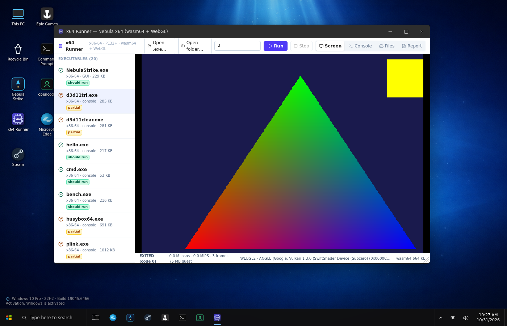

# Direct3D 11 in the Nebula x64 emulator — the "DXVK for the browser" layer

**Goal.** Windows programs talk to `d3d11.dll`/`dxgi.dll`; the browser only has WebGL2 / WebGPU.
DXVK does the same translation for Linux (D3D → Vulkan), ANGLE does the opposite direction inside
browsers (WebGL → D3D/Metal/Vulkan). What Nebula needs is **D3D11 (guest) → WebGL2 (host)**, built
in the same incremental, test‑first way as the rest of the emulator.

## Stage 1 — shipped (v1.12.1): COM, device, swap chain, clears, Present

| piece | where | notes |
| --- | --- | --- |
| vtable tables | `emu/x64/d3d_vtables.h` | generated from mingw‑w64 `d3d11.h`/`dxgi.h`, so the method order is the real ABI (`ID3D11Device` 43 methods, `ID3D11DeviceContext` 115, `IDXGISwapChain` 18, …) |
| COM objects | `emu/x64/d3d11.inc` | guest block `{vtable, id, refcount}`; every vtable slot is a named shim `d3d11!ID3D11DeviceContext::DrawIndexed` — a method that is not implemented stops the program with its exact name (no silent `S_OK`) |
| entry points | `D3D11CreateDevice`, `D3D11CreateDeviceAndSwapChain` (feature level 11_0), `CreateDXGIFactory*` (honest `E_NOINTERFACE` for now) | |
| device | `CreateTexture2D`, `CreateBuffer`, `CreateRenderTargetView/DepthStencilView/ShaderResourceView`, `CreateVertex/PixelShader` (bytecode kept for stage 2), `CreateInputLayout`, blend/depth/rasterizer/sampler states, `CreateQuery`, `GetImmediateContext`, `GetFeatureLevel`, `CheckFormatSupport`, `CheckMultisampleQualityLevels` | |
| context | `OMSetRenderTargets`, `ClearRenderTargetView` (float RGBA → BGRA fill of the software surface), `ClearDepthStencilView`, `RSSetViewports/ScissorRects`, `IASet*`, `VS/PSSetShader`, constant buffers/samplers/SRVs/states (recorded), `Map/Unmap`, `UpdateSubresource`, `Flush`, `ClearState` | `Draw`, `DrawIndexed`, `CopyResource`, … → **STOP: unimplemented API d3d11!ID3D11DeviceContext::Draw** |
| swap chain | `GetBuffer`, `Present` (back buffer → window framebuffer → WebGL2 canvas / `--frames` PPM dumps; yields to the host frame loop like GDI blits), `GetDesc`, `ResizeBuffers`, `Set/GetFullscreenState`, `GetDevice` | |

Test: `emu/tests/d3d11clear.c` (built with `zig cc -target x86_64-windows-gnu -ld3d11 -ldxguid -luser32`) —
window + device + swap chain, three frames cleared to (0.2,0.4,0.9), (0.9,0.3,0.1), (0.1,0.8,0.3):

```
$ ./emu/x64/x64run --quiet --no-stdin --frames 1 emu/tests/d3d11clear.exe
device ok, feature level 0xb000
backbuffer 640x480 format 87
frame 0 presented (0.2 0.4 0.9)
frame 1 presented (0.9 0.3 0.1)
frame 2 presented (0.1 0.8 0.3)
d3d11clear ok
$ # frame_0001.ppm = (51,102,230), frame_0002.ppm = (230,77,26), frame_0003.ppm = (26,204,77)
```

`emu/tests/run.sh` checks the pixels of all three frames in CI.

## Stage 2 — shipped (v1.12.1): draw calls through WebGL2



| piece | where | notes |
| --- | --- | --- |
| **DXBC → GLSL ES 3.00** | `emu/x64/dxbc.c` | parses the DXBC container (`SHDR`/`SHEX`, `ISGN`, `OSGN`), decodes SM4/SM5 operand tokens (swizzles, masks, modifiers, relative indexing, immediates, extended tokens) and translates ~90 opcodes: mov/movc, add/mul/mad/div, dp2/3/4, min/max, sqrt/rsq/exp/log/frc/round_*, sincos, lt/ge/eq/ne (+ integer/unsigned variants) producing D3D's 0xFFFFFFFF masks, and/or/xor/not, iadd/imul/imad/ineg/ishl/ishr/ushr/udiv, ftoi/itof/ftou/utof, sample/sample_l/sample_b/sample_c, ld, resinfo, deriv_rtx/rty, if/else/endif/loop/endloop/break(c)/continue(c)/retc/discard, customdata (immediate constant buffers). Varyings are named after the D3D semantic (`va_TEXCOORD0`) so VS/PS pairs link like D3D; `SV_Position` → `gl_Position` with the D3D → GL clip‑space fix (y flip, z 0..1 → −1..1); constant buffers → std140 blocks `vs_cb#`/`ps_cb#`; textures → `sampler2D t#`. Unsupported opcodes/program types stop the program with the opcode number. |
| draw command | `emu/x64/gfx_cmd.h`, `d3d11.inc: gfx_draw()` | one 160‑word command per `Draw`/`DrawIndexed`: shaders, topology, vertex buffers (stride/offset), **input layout matched to the VS signature by semantic**, index buffer, VS/PS constant buffers (re‑uploaded each draw — apps `Map` them), PS textures + sampler states, render target / depth, viewport, scissor, blend/depth/rasterizer state |
| WebGL2 back end | `src/lib/x64/gfx.ts` | offscreen WebGL2 context: shader compile/link cache, buffers by D3D bind flag, textures (RGBA8/BGRA8/R8/RG8/RGBA32F + depth renderbuffers), FBO per render target, GL state from the command, `drawArrays`/`drawElements`; `Present` reads the target back into the guest's back buffer so the ordinary window presenter shows it |
| test | `emu/tests/d3d11tri.c` (`public/x64/samples/d3d11tri.exe`) | SDL2's precompiled `vs_4_0_level_9_1` + `ps_4_0_level_9_1` shaders, 36‑byte vertices (POSITION/TEXCOORD/COLOR), `Draw(3)` + `DrawIndexed(6)`, constant buffer updated through `Map(WRITE_DISCARD)`; e2e (`e2e/run.mjs`) runs it in headless Chromium and checks the red/green/blue triangle, the yellow indexed quad and the clear colour on the canvas |

The native runner (`x64run`) has no GPU: it translates the shaders and stops at the first `Draw` with
*"this host has no GPU back end"* — `run.sh` checks exactly that.

## Not yet

* instancing, geometry/hull/domain/compute shaders, UAVs, stream‑out, MSAA, `CopyResource`/`CopySubresourceRegion`, staging readback, texture arrays / cubes / 3D, mipmap generation, queries, `DXGI` factory/adapter enumeration (`CreateDXGIFactory` → `E_NOINTERFACE`), swap‑chain flip models beyond "copy to the window"
* D3D9 (SM 1–3) — a separate translator

## Honest limits

* The CPU is an interpreter at 40–65 MIPS. Even with a complete D3D11 layer, a real game's CPU side
  (physics, scripting, Unity/Mono, Unreal) needs 1–3 GHz of native speed — hundreds of times more.
  The D3D11 layer makes **small D3D11 programs, demos and tools** feasible, not AAA titles.
* Feature level 11_0 is advertised; compute shaders, tessellation, geometry shaders, UAVs and
  multisampling will be reported as unsupported when asked.
