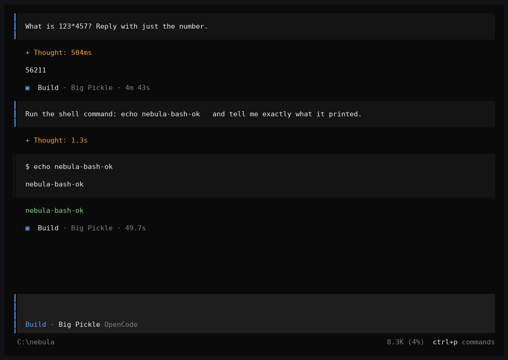
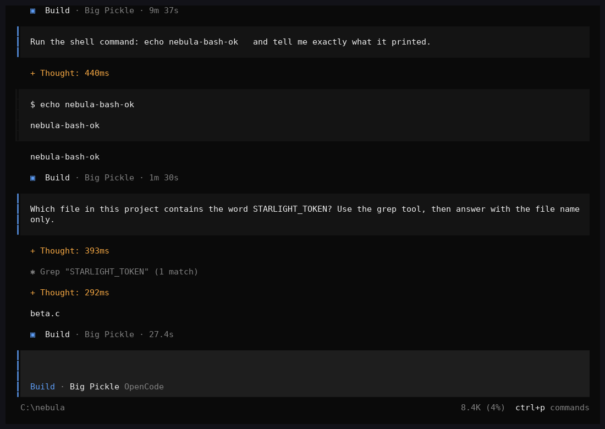

# opencode (Bun standalone, Windows x64) inside Nebula x64

Reproducible recipe used for the screenshots in `docs/screenshots/` (native runner, 2 cores / 2 GB sandbox):

```bash
# 1. build the emulator
./emu/x64/nbuild.sh && ./emu/tests/run.sh          # 110 checks, ALL OK

# 2. get the real opencode binary (Bun 1.4.4 standalone, 211 MB)
curl -sL https://registry.npmjs.org/opencode-windows-x64-baseline/-/opencode-windows-x64-baseline-1.19.5.tgz | tar xz
# optional: a home directory with rg.exe so opencode does not download ripgrep
mkdir -p home/.cache/opencode/bin && cp public/x64/apps/rg.exe home/.cache/opencode/bin/

# 3. terminal query responder (OpenTUI asks the terminal for size/colours/capabilities over stdin)
mkfifo in.fifo
python3 emu/tools/tui_respond.py tui.out in.fifo &

# 4. run the TUI (first frame after ~9 min / 42 G instructions at ~65 MIPS)
X64_GUEST_ENV="OPENCODE_DISABLE_MODELS_FETCH=1;OPENCODE_DISABLE_AUTOUPDATE=1;OPENCODE_EXPERIMENTAL_DISABLE_FILEWATCHER=1;OPENCODE_DISABLE_FFF=1" \
X64_TAP='opencode\log' X64_LOG=1 \
./emu/x64/x64run --max-ms 3600000 --mount "$PWD/home=C:\Users\user" package/bin/opencode.exe > tui.out 2> tui.err 3>&2 < in.fifo

# 5. type into it (keyboard goes through the FIFO) and render the screen to PNG
printf 'Reply with exactly one short sentence: what is 2+2?' > in.fifo; sleep 30; printf '\r' > in.fifo
python3 emu/tools/vt_render.py tui.out 120 40 screen.png
```

Measured on 2026‑10‑31 (run #24): instance 08:36 → config 08:41 → `init` 08:41:31 → `init count=1` 08:47 → first frame 08:47:30 →
prompt typed 08:48:50 → session created 08:50:06 → request to `opencode.ai` (Big Pickle) 08:55:39 → **answer «2 + 2 equals 4.» rendered 08:57:33** (6 m 42 s on the opencode side).
Peak RSS 1.1 GB (JSC heap with 4 GB reported RAM), 13 guest threads, ~190 short‑lived libuv wait threads.

What had to be implemented for this (all in `emu/x64/`):
`Nt*` file/VM services and PEB `ProcessParameters` (Zig std + Bun), Winsock + IOCP + `select`/`WSAPoll` (libuv slow‑poll used by uSockets), `recv(s,NULL,0)` connection probe,
exe‑export lookup in `GetProcAddress` (Node‑API add‑on delay‑loads `napi_*` from `node.exe` = the host exe), waitable console input handle + `RegisterWaitForSingleObject`
(libuv raw tty reader), UTF‑8 → UTF‑16 key records, non‑blocking raw stdin in the native runner, `X64_TAP` (mirror guest file writes to stderr) for the opencode log.

Limits: in the browser (wasm64) there is no raw TCP, so the LLM request cannot leave the page, and the interpreter is ~2× slower than native — the TUI would need ~20 min to its first frame and >1 GB; the native runner is the practical host for it today.

## Child processes (v1.12.1)

opencode's `bash` tool and Bun's `Bun.spawn` / Node's `child_process` read a child's stdout the libuv way:
`CreateNamedPipeA("\\?\pipe\uv\…", DUPLEX|OVERLAPPED)` + IOCP + **zero‑byte `ReadFile`** as a readiness
probe, then a real `ReadFile` whose `OVERLAPPED.hEvent` has the low bit set (= "do not post a completion
packet"). v1.12.1 implements exactly that: the zero‑read completes with success when data is buffered and
with `ERROR_BROKEN_PIPE` once the writer is gone, quiet reads skip the port, and
`RtlNtStatusToDosError(0x8007xxxx)` returns the embedded Win32 code (libuv stores errors that way).

```
node -e "cp.spawnSync('C:\\Windows\\System32\\cmd.exe',['/c','echo hi'])"   → status 0, stdout "hi\r\n"
node -e "cp.exec('echo async node', …)"                                    → "async node\r\n"
bun  -e "Bun.spawnSync([...cmd,'/c','echo hi from bun'])"                   → exit 0, "hi from bun\r\n"
bun  -e "Bun.spawn([...], {stdout:'pipe'})"                                 → "async hi\r\n"
```
`emu/tests/uvpipe.exe` replays the sequence in plain C and is part of `run.sh`.

## Running it on GitHub instead of a laptop

`.github/workflows/opencode-x64.yml` (manual, weekly, and on `v*` tags) builds the native runner on `ubuntu-latest`,
downloads the unmodified `opencode-windows-x64-baseline` 1.19.5 from npm, starts the TUI through the emulator with
`emu/tools/tui_respond.py` answering the terminal queries, and `emu/tools/tui_drive.py` types a prompt, waits for the
answer, then asks the agent to run `echo nebula-bash-ok` through its bash tool.  Terminal screenshots of every stage are
uploaded as the `opencode-tui-screenshots` artifact and the last screens land in the job summary.

Result of run [41202512110](https://github.com/sj0404-collab/nebula_gaming/actions/runs/41202512110) (ubuntu-latest,
2026-10-31): first frame after 8 min, `123*457` → `56211` after another 6 min, then the agent used its bash tool —
the emulator log shows `CreateProcess(C:\Windows\System32\cmd.exe /d /s /c "echo nebula-bash-ok")` — and the TUI
rendered the command, its output and the final answer:



Run [41206004528](https://github.com/sj0404-collab/nebula_gaming/actions/runs/41206004528) added a fourth stage: ripgrep
(`rg.exe` from the bundled samples) is pre-installed in `~/.cache/opencode/bin`, a small demo project
(`emu/tools/opencode-project`) is mounted as `C:\nebula`, and the agent is asked which file contains `STARLIGHT_TOKEN`.
It ran `rg.exe --json … STARLIGHT_TOKEN .` as a child process (visible in the emulator log), got 1 match and answered
`beta.c`:



Since v1.13.0 the runner no longer pre-installs `rg.exe`: the emulator ships its own `powershell.exe`
(`emu/pwsh/pwsh.c`, embedded at `C:\Windows\System32\WindowsPowerShell\v1.0` and on `PATH`), so opencode's ripgrep
bootstrap runs unchanged — it downloads the `ripgrep-*-x86_64-pc-windows-msvc.zip` release over the emulated socket layer
and unpacks it with the exact spawn it uses on real Windows,
`cmd.exe /d /s /c "powershell.exe ^"-NoProfile^" ^"-NonInteractive^" ^"-Command^" ^"… Expand-Archive -LiteralPath … -Force^""`
(`emu/tests/run.sh` block 17 replays that spawn against `emu/tests/pwtest.zip`).  Because `powershell` is now on `PATH`,
opencode's `Shell.acceptable()` also picks it for the bash tool (`powershell -NoProfile -Command "<cmd>"`) instead of
`cmd.exe` — the mini-PowerShell runs `echo`, pipelines, `&` external programs and `cmd /c …`, which is what the agent
actually issues; anything outside its subset fails with a PowerShell-style "The term … is not recognized" error.

## `npm install opencode-ai` inside the emulator (v1.14.0)

The user-facing install route — `node.exe` + `npm` from the official Node.js 24 win-x64 zip, nothing patched — runs
on the emulated Windows end to end (measured on the 2-core sandbox):

```
node.exe npm-cli.js --version                      → 11.6.1                          9 s
node.exe npm-cli.js view opencode-ai version       → 1.19.5 (registry over TLS)      2 m 40 s
node.exe npm-cli.js install <opencode-ai.tgz> <opencode-windows-x64-baseline.tgz>
   download 79.6 MB → npm-cache/_cacache (sha512), extract 211 MB opencode.exe into node_modules,
   postinstall: cmd.exe /d /s /c node ./postinstall.mjs
       → powershell.exe -NoProfile -NonInteractive -Command "(Add-Type … )::IsProcessorFeaturePresent(40)"  → False (no AVX2 here)
       → copy node_modules/opencode-windows-x64-baseline/bin/opencode.exe → opencode-ai/bin/opencode.exe
       → opencode.exe --version (child process, exit 0)                              ≈ 18 min
node.exe npx-cli.js opencode --version             → cmd.exe /d /s /c opencode --version
                                                   → node_modules\.bin\opencode.cmd → opencode.exe → 1.19.5   1 m 40 s
```

The full `npm install opencode-ai` (resolving all 13 platform packages) additionally parses ≈ 90 MB of registry
metadata inside the guest, which needs more than the sandbox's 2 GB — `.github/workflows/npm-opencode-x64.yml` runs
that form on a 16 GB runner (with the tarball-URL form as a fallback) and then drives the npm-installed TUI.

What it took (all in `emu/x64/`):

* **write-back mounts** (`--mount-rw host=guest`): files the guest creates or modifies are written to the host folder
  when the last handle closes and dropped from RAM (reloaded lazily on the next open); `mkdir`/`rename`/`delete`
  are mirrored too (`host_fs_op` in `host_native.c`, `node_sync`/`node_load` in `vfs.c`).  Before this, every
  extracted file stayed in memory and npm ran out of RAM at ≈ 1.3 GB.
* `CreateProcessW` honours `lpEnvironment` (UTF-16 block) — npm's `PATH=…\node_modules\.bin;…` for scripts and `npx`
  was silently dropped before, so `opencode` was "not recognized" by `cmd.exe`.
* `GetModuleFileName(NULL)` / PEB `ImagePathName` report the real image path (`C:\node\node.exe`), so
  `process.execPath` is right and run-script's `PATH` prefix points at a directory that has `node.exe`.
* `FileDispositionInfo(Ex)` / `FileDispositionInformation(Ex)` / `FILE_FLAG_DELETE_ON_CLOSE`: delete-on-close with
  POSIX semantics and `ERROR_DIR_NOT_EMPTY` for non-empty directories — `fs.rmSync({recursive})` is
  `std::filesystem::remove_all`, which first tries to delete the top entry that way and only recurses when that fails.
* `C:\nebula` became a real directory node (it was implicit = "the cwd", so `lstat` failed after a `cd`).

### Speed

The interpreter got a 4 KB-page translation cache (TLB) and a host-side fast path for forward `rep movs`/`rep stos`
(commit 1625985): `opencode.exe --version` 69.9 s → 58.5 s and a Lua benchmark 25.9 s → 20.1 s on the same machine
(~55–73 MIPS). A predecoded basic-block cache would be the next step for a bigger jump.
